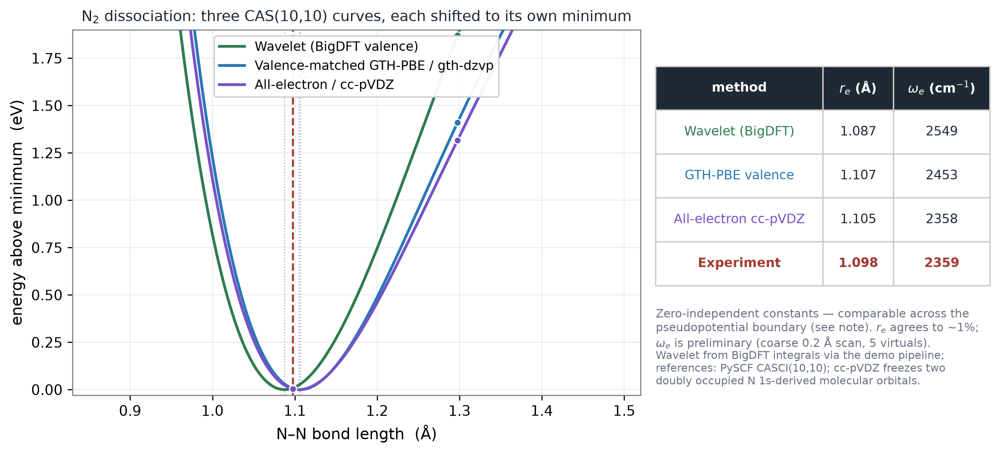

# Wavelet quantum chemistry with BigDFT

This branch turns the original NTU research archive into a compact, reproducible
case study:

```text
BigDFT Daubechies wavelets
        ↓  hpq / hpqrs electron integrals
active-space reduction
        ↓
fermionic Hamiltonian → Jordan–Wigner qubits
        ↓
exact diagonalization / VQE / QSCI / SQD
```

The main completed result is an N₂ potential-energy curve built from wavelet
integrals and compared on scientifically matched footing with Gaussian-basis
references. The original project did not complete this comparison; the later work
here closes that gap and preserves the earlier 109Asp calculation as a documented
scaling limit rather than an energy result.



## Headline result

All three calculations use a ten-electron, ten-orbital valence active space. In
the all-electron cc-pVDZ calculation, the two N 1s molecular core orbitals are
frozen so that the correlated electron count matches the pseudopotential cases.

| method | electrons represented in total energy | correlated space | rₑ (Å) | ωₑ (cm⁻¹) |
|---|---:|---:|---:|---:|
| BigDFT wavelet / HGH-PBE | 10 valence | CAS(10,10) | 1.087 | 2549 |
| PySCF GTH-PBE / gth-dzvp | 10 valence | CAS(10,10) | 1.107 | 2453 |
| PySCF all-electron / cc-pVDZ | 14 total; 4 frozen-core | CAS(10,10) | 1.105 | 2358 |
| experiment | — | — | 1.098 | 2359 |

The absolute BigDFT energy is about −20 Ha, while the all-electron curve is about
−109 Ha. Those totals have different cores and different energy zeros and must
not be subtracted. The table compares minimum-shifted curve shape, equilibrium
bond length, and curvature instead. The wavelet `rₑ` is within about 1% of
experiment. Its frequency is preliminary because the archived scan is spaced by
0.2 Å near equilibrium and contains only five virtual orbitals.

See [RESULTS.md](RESULTS.md) for the numerical interpretation and limitations,
and [docs/METHODOLOGY.md](docs/METHODOLOGY.md) for the equations and comparison
protocol.

## Reproduce the compact pipeline

The repository defaults to Python 3.12 and uses a lockfile. Every numerical or
installation command below is run through a dependency-free process-tree memory
guard.

```bash
# Create/synchronize the Python environment (plots + tests included).
python3 tools/run_with_memory_guard.py \
  --max-rss-gb 8 --min-free-percent 15 --threads 2 -- \
  uv sync --extra analysis --extra dev

# Core validation.
python3 tools/run_with_memory_guard.py \
  --max-rss-gb 8 --min-free-percent 15 --threads 2 -- \
  uv run pytest -q

# Walk through the scientific pipeline.
uv run python scripts/01_validate_n2.py
uv run python scripts/02_active_space.py
uv run python scripts/03_map_and_diag.py
uv run python scripts/04_vqe.py
uv run python scripts/05_sqd_qsci.py
uv run python scripts/06_dissociation.py
uv run python scripts/gen_headline_plot.py
uv run python scripts/08_scan_analysis.py
uv run python scripts/09_109asp_wall.py
uv run python scripts/10_wavelet_figures.py
```

The scripts after environment setup are small, but use the guard around any new
or modified workload. `scripts/07_param_scan.py` enforces this automatically
because it launches native BigDFT jobs.

## What is verified

- The compact Python test suite checks integral permutation symmetry, HF
  reconstruction, Jordan–Wigner vs independent PySCF FCI, a physical negative
  correlation energy, the N₂ bond length, QSCI→FCI in the complete selected
  subspace, and SQD→FCI on the small active space.
- A fresh Apple-Silicon compile of `toy_model_cpu.f90` succeeded with gfortran
  13.4.0 and an existing compatible BigDFT installation. The output binary was
  repaired to use an `@rpath` `libyaml` dependency.
- The native N₂ extraction produced all 240 `hpq` and 7,260 `hpqrs` records.
  Against the archived reference, maximum absolute differences were
  `5e-12 Ha` and `1e-12 Ha`; observed process-tree RSS was 1.62 GiB.
- Stock BigDFT 1.9.6 and the 2026-03-09 `devel` revision are **not** source
  compatible with this extractor. The verified build uses a patched 2024
  research tree. Run `tools/check_bigdft_compatibility.py` before building.

This last point corrects the earlier shorthand that the extractor had been
“updated for the latest BigDFT.” It had been updated for the locally patched API
line, not for an unmodified current release. Details and exact revisions are in
[docs/COMPATIBILITY.md](docs/COMPATIBILITY.md).

## QSCI and SQD result provenance

`scripts/05_sqd_qsci.py` exercises both selected-CI paths on the real wavelet
Hamiltonian. Its samples are drawn from the exact PySCF FCI coefficient
distribution so that the classical QSCI/SQD stages can be validated without a
QPU. This is a **classical sampler oracle**, not hardware data. The archived
QURI-QSCI cross-stack result is retained only as a negative diagnostic because it
stayed 3.979 Ha from CASCI; it is not included as a successful result.

See [docs/SQD_QSCI.md](docs/SQD_QSCI.md).

## Repository map

```text
src/wavelet_qc/       integral loading, active space, mappings, solvers
scripts/              numbered, runnable analysis workflow
tests/                independent numerical invariants
data/n2/              complete 15-orbital equilibrium integral fixture
data/n2_scan/         compact eight-geometry CAS(10,10) integral scan
data/109asp/           metadata only; large/incomplete tensors are not vendored
results/data/          machine-readable result records
results/figures/       regenerated publication/blog figures
bigdft/postprocessing verified GPL-2.0 toy_model source
bigdft/macos/          portable build/run helpers and verification manifest
docs/                  method, compatibility, provenance, and reports
tools/                 memory guard and static/numerical checkers
```

The older `energy-calculation/`, `qubit-encoding/`, and other BigDFT files remain
as historical context. The maintained path is the package and numbered scripts
above.

## Reports

- [Report status and errata](docs/reports/README.md)
- [Wavelet-QC first-principles primer (archived draft)](docs/reports/wavelet_qc_primer.pdf)
- [Zapata interview project deck](docs/reports/zapata_wavelet_project_deck.pdf)
- [Selected literature and primary references](docs/REFERENCES.md)

The PDFs preserve their presentation context. The deck describes the state of the
project *then* (the N₂ comparison was unfinished), and the primer draft predates
the HGH-K/GTH distinction corrected in this branch. This README, `RESULTS.md`, and
`docs/METHODOLOGY.md` are authoritative for the completed work.

## Attribution and licensing

The integral loader, HF reconstruction, and MP2 active-space logic are cleaned-up
ports of Shih-Kai Chou’s NTU `BigQiskit.py`. The original BigDFT `toy_model`
and Poisson-solver construction were Shih-Kai Chou’s; the API port, correctness
fixes, N₂/109Asp runs, macOS build, and downstream quantum workflow include work
by Po-Jen Wang and collaborators, with the integral engine developed with
Jing-Yan Huang. See [docs/PROVENANCE.md](docs/PROVENANCE.md) for the detailed
boundary.

The repository as a whole does not currently declare a single project license.
The BigDFT-derived Fortran file retains its upstream GNU GPL v2 notice and is
accompanied by [licenses/BigDFT-GPL-2.0.txt](licenses/BigDFT-GPL-2.0.txt). See
[THIRD_PARTY_NOTICES.md](THIRD_PARTY_NOTICES.md) before reuse.
